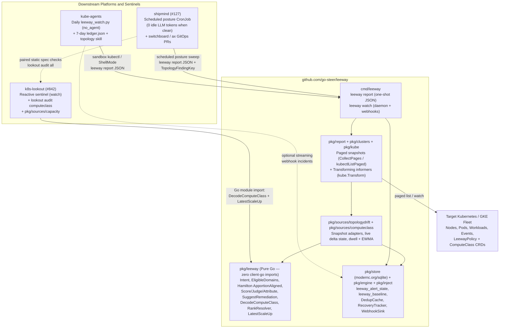

`leeway` evaluates runtime Kubernetes placement posture — whether running workloads hold their intended failure-domain spread (`topology-drift`) and whether GKE `ComputeClass` workloads run on their preferred priority tiers (`compute-class`).

## Where `leeway` sits across the stack

Extracted from `k8s-lookout`, `github.com/go-steer/leeway` serves three consumers across two external boundaries: the `leeway report` CLI (`leeway.report/v1alpha1` JSON) / `leeway watch` webhook wire contract, and the pure `github.com/go-steer/leeway/pkg/leeway` Go module API.

### Consumer boundaries

1. **`kube-agents`:** Runs `leeway report` on a daily schedule (`leeway_watch.py`) inside `agent-sandbox` via `CREDENTIAL_PROXY_URL` (`ShellMode`), deduplicates active findings in a 7-day ledger using [deterministic finding keys](/reference/stability-policy/#2-finding-identity-cross-sweep-deduplication-key), and turns `remediation.yaml` (`manifest_patch`) into GitOps pull requests when an operator replies in chat. Deployments needing sub-minute streaming alerts can also subscribe to `leeway watch` HTTP webhooks.
2. **`shipmind` ([`go-steer/shipmind#127`](https://github.com/go-steer/shipmind/issues/127)):** Pairs `k8s-lookout`'s static spec checks (`lookout audit`) with `leeway report` (runtime placement skew and `ComputeClass` fallback occupancy, without installing `LeewayPolicy` CRDs on target clusters). Scheduled posture sweeps run deterministically with zero standing informer RAM between runs and zero LLM tokens when clusters are clean or unchanged, posting digests through `switchboard` and waking an `ax` task only when new or refresh-due findings appear.
3. **`k8s-lookout` ([`go-steer/k8s-lookout#842`](https://github.com/go-steer/k8s-lookout/issues/842)):** Keeps `lookout watch --sources=auto` strictly reactive (crash loops, stalled rollouts, node/gateway failures) and retires its duplicate in-tree leeway sources in favor of `go-steer/leeway`. Two `k8s-lookout` components import the pure `github.com/go-steer/leeway/pkg/leeway` library directly:
   - `lookout audit computeclass` imports `DecodeComputeClass` and the static `ComputeClass` / `PreferenceAxis` types to validate priority rules at audit time.
   - `pkg/sources/capacity` imports `LatestScaleUp`, `IsScaleUpReason`, `ScaleUpVerdict`, `AutoscalerEvent`, and the `Reason*ScaleUp` constants to gate `FailedScheduling` incidents on Cluster Autoscaler scale-up verdicts.

Compatibility rules across all three consumers are governed by the [Stability policy](/reference/stability-policy/).

## Package layering invariants

Two structural rules keep `pkg/leeway` embeddable and keep cluster reads memory-bounded (enforced in CI by `pkg/leeway/purity_test.go`, `pkg/sources/layering_test.go`, and `pkg/kube/transform_wiring_test.go`):

- **`pkg/leeway` is pure Go.** It depends only on standard library packages plus `k8s.io/api` and `k8s.io/apimachinery` value structs — never `k8s.io/client-go`, `internal/...`, `pkg/sources`, or `pkg/store`.
- **`pkg/...` never imports `internal/...`, and every cluster read is paged and trimmed.** `leeway watch` builds shared informers through `kube.NewTransformingFactory`, while `leeway report` pages API lists through `kube.CollectPages` (`client-go`) or `kubectlListPaged` (`CREDENTIAL_PROXY_URL` `ShellMode`), applying `kube.Transform` to every page so container env secrets and unused status blobs never accumulate in memory.

## Data-flow guides

Follow the four execution and scoring pipelines in detail:

1. **[One-shot `leeway report` flow](/getting-started/report/#how-leeway-report-executes)** — Target discovery, paged + `kube.Transform`-trimmed snapshots (`client-go` and `ShellMode`), dwell-bypassed evaluation, `leeway.report/v1alpha1` JSON, and deterministic `Remediation`.
2. **[Continuous `leeway watch` flow](/getting-started/deploy/#how-leeway-watch-executes)** — Transforming informers, `AlertState` dwell/hysteresis, `BaselineSet` EWMA learning, SQLite `pkg/store`, `pkg/inject` webhooks, and recovery tracking.
3. **[Topology scoring & attribution pipeline](/concepts/scoring-and-attribution/#end-to-end-scoring-pipeline)** — Intent precedence, eligible domains, tie-aligned Hamilton apportionment, drift scores, causal attribution, confidence tiers (`A`/`B`/`C`), and severity.
4. **[ComputeClass priority-rank pipeline](/concepts/compute-class-ranks/#rank-evaluation-pipeline)** — `DecodeComputeClass`, node rank resolution (`ccc_priority_index` + node labels), rolling pod-seconds accounting, and the four `leeway.rank_*` findings.
