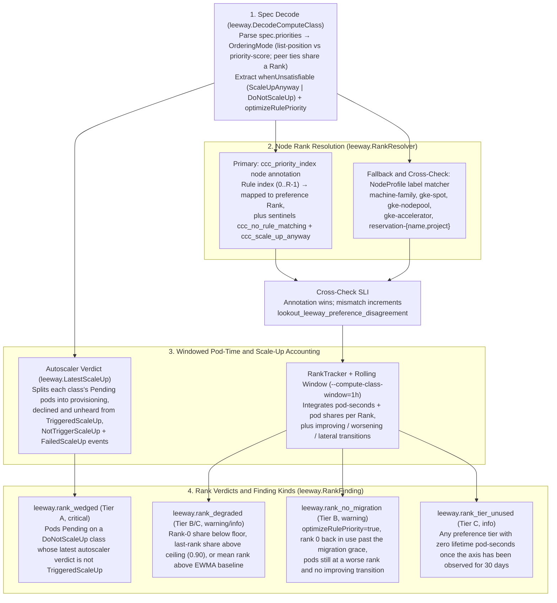

GKE `ComputeClass` (`cloud.google.com/v1`) lets operators define an ordered list of `priorities` (machine families, spot vs. on-demand, nodepool labels, accelerators, or reservations), a `whenUnsatisfiable` policy (`ScaleUpAnyway` vs. `DoNotScaleUp`), and optional `activeMigration.optimizeRulePriority`.

Admission-time metrics tell you whether pods scheduled, not **which priority rank** in the ladder they actually landed on. `leeway`'s `compute-class` source tracks achieved priority ranks over time so silent fallback onto lower-priority hardware surfaces before cost or latency SLOs drift.

## Rank evaluation pipeline

## How rank resolution works

For every node carrying `cloud.google.com/compute-class=<name>`:
1. If GKE has stamped the `ccc_priority_index` node annotation, `leeway` maps that rule index onto the class's preference `Rank` (honoring `priorityScore` ordering and peer ties, as well as the `ccc_no_rule_matching` and `ccc_scale_up_anyway` sentinels) **and** runs its own label matcher against `spec.priorities`. If the two disagree, the annotation wins and `leeway` increments `lookout_leeway_preference_disagreement`.
2. While `ccc_priority_index` is absent (for example during the initial ~30–45 seconds of a newly provisioned node's life), `leeway` infers the rank directly by matching each `spec.priorities[i]` rule against the node's labels (`cloud.google.com/machine-family`, `cloud.google.com/gke-spot`, `cloud.google.com/gke-nodepool`, `cloud.google.com/gke-accelerator`, `cloud.google.com/reservation-name`, `cloud.google.com/reservation-project`, etc.), failing closed on unmodeled rule fields (`lookout_leeway_preference_unsupported_rules`).

## The four rank finding kinds

`leeway` integrates **pod-seconds per rank** and evaluates four rules. The two share rules are judged over a rolling window (`--compute-class-window`, default `1h`); the other three read Pending pods, rank transitions and lifetime totals:

| Finding Kind | Tier | Default Severity | Condition |
| --- | --- | --- | --- |
| `leeway.rank_wedged` | **A** | `critical` | The class declares `whenUnsatisfiable: DoNotScaleUp` and has Pending pods whose latest autoscaler verdict is not `TriggeredScaleUp`: either the autoscaler declined (`NotTriggerScaleUp` / `FailedScaleUp`) or no verdict was observed. Pods running on a node stamped `ccc_no_rule_matching` are counted at rank `unsatisfiable` and do not raise this finding. |
| `leeway.rank_degraded` | **B** | `warning` | Share of pod-seconds on `rank 0` drops below `--compute-class-rank0-floor` (opt-in), OR share on the last fallback rank (`K-1`) exceeds `--compute-class-last-rank-ceiling` (default `0.90`). |
| `leeway.rank_no_migration` | **B** | `warning` | `spec.activeMigration.optimizeRulePriority: true` is declared, rank `0` has come back into use for longer than the migration grace (`15m`), pods remain at a worse rank, and no pod moved to a better rank in the window. `leeway` does not inspect idle node capacity. |
| `leeway.rank_tier_unused` | **C** | `info` | Any preference tier, rank `0` and the last rank included, has accrued zero pod-seconds for the whole time the axis has been observed, once that is at least 30 days. One finding per tier; `leeway watch` only (emitted as a signal when `--compute-class-tier-c-signals` is set). |
