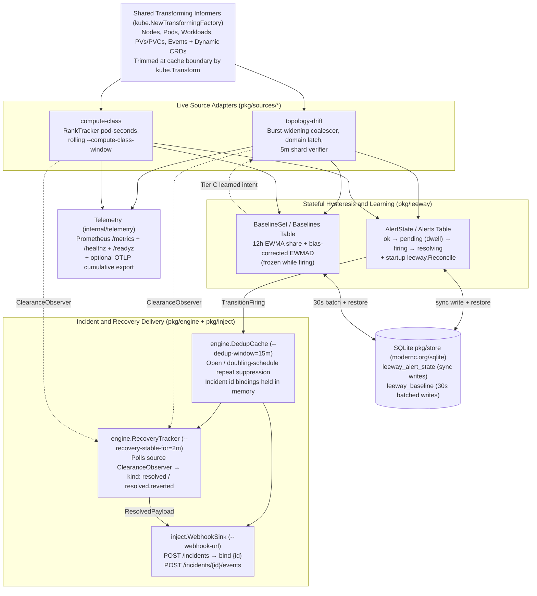

`leeway watch` runs continuously as a daemon. Unlike `leeway report`, which evaluates a single point-in-time snapshot, `leeway watch` maintains live Kubernetes informers, tracks dwell and resolution hysteresis (`--topology-dwell`, `--compute-class-dwell`), learns per-subject baselines (persisted across restarts with `--store`), serves Prometheus `/metrics`, and delivers incident and resolution events to an HTTP webhook callback.

## How `leeway watch` executes



## Deploying in-cluster with Kustomize

Apply the base manifests in `deploy/` (creates the `leeway` ServiceAccount, read-only ClusterRole, ClusterRoleBinding, metrics Service, and Deployment in namespace `agent-triage`):

```sh
kubectl create namespace agent-triage
kubectl apply -k deploy/
```

Optionally install the `LeewayPolicy` and `ClusterLeewayPolicy` CRDs so workload owners can declare explicit placement contracts and severity overrides:

```sh
kubectl apply -f deploy/crds/leewaypolicies.yaml
```

## Configuring the HTTP webhook callback

To send incident notifications and recovery events to an external HTTP webhook receiver, pass `--webhook-url`:

```sh
leeway watch \
  --in-cluster \
  --cluster-name=prod-us-east1 \
  --webhook-url=http://incident-receiver.monitoring.svc:8080 \
  --sink-token-env=LEEWAY_WEBHOOK_TOKEN \
  --store=/var/lib/leeway/leeway.db \
  --metrics-addr=:9090
```

## Watching multiple clusters from one daemon

`leeway watch` accepts the same multi-cluster discovery flags (`--clusters`, `--clusters-from`, `--profiles-dir`) as `leeway report`. When multiple clusters are resolved, a single `leeway watch` process starts an isolated informer set per cluster, shares the `/metrics`, `/healthz`, and `/readyz` server, and stamps every metric series and webhook payload with its originating `cluster` name:

```sh
leeway watch \
  --clusters-from=kubeconfig:/etc/leeway/kubeconfig \
  --webhook-url=http://incident-receiver.monitoring.svc:8080 \
  --metrics-addr=:9090
```
