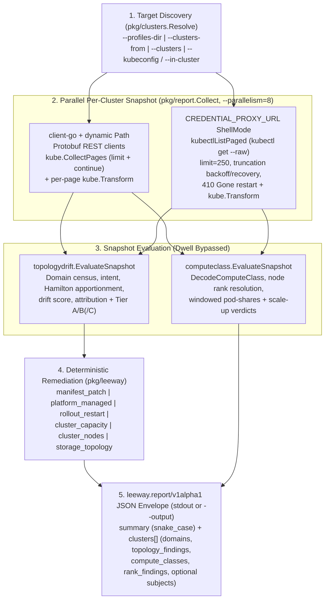

`leeway report` is a stateless, one-shot CLI mode designed for external processes, CI/CD checks, and AI troubleshooting agents. It connects to one or more Kubernetes clusters in parallel, lists the placement-relevant objects one page at a time, evaluates every subject with dwell timers bypassed, and prints a single JSON report.

## How `leeway report` executes



## Specifying target clusters

`leeway report` resolves clusters from four sources, tried in this order. The first one that is set wins.

### 1. Hermes profiles directory (`--profiles-dir`)

Point `leeway` at a directory of Cluster Agent profiles. A subdirectory counts as a cluster profile when its `config.yaml` carries a complete `cluster_identity` block (`project`, `location`, `cluster`):

```sh
leeway report --profiles-dir=/opt/data/profiles
```

`--clusters` acts as a filter here: name a cluster, a `project/location/cluster` triple, or a profile directory to restrict the run.

### 2. Fleet discovery (`--clusters-from`)

`--clusters-from` names one or more comma-separated discovery scopes, not a file. Each scope accepts:

- `kubeconfig` or `kubeconfig:/path/to/config` — one target per context in the kubeconfig (`--kubeconfig` supplies the path when none is given).
- `profiles:/path/to/profiles` — the same as `--profiles-dir`.
- `<project>`, `<project>/<location>`, or `projects/<project>/locations/<location|->` — every GKE cluster listed under that project (and location) via the GKE API.

```sh
leeway report --clusters-from=kubeconfig --output=report.json
leeway report --clusters-from=my-project/us-central1,other-project
```

When multiple scopes are listed and one fails discovery while at least one other succeeds, `leeway report` (and `leeway mcp`) emits a `clusters[]` entry with `"status": "error"` for the failed scope rather than failing the whole run. `--clusters` filters the discovered set in the same way.

### 3. Explicit `--clusters` list

With no discovery source, `--clusters` is a comma-separated list of targets, each one of:

- `projects/project/locations/location/clusters/cluster`, `project/location/cluster`, or `gke_project_location_cluster` — resolved against matching kubeconfig contexts (`gke_<p>_<l>_<c>`, `<p>/<l>/<c>`, or exact context name) when `--kubeconfig` or `KUBECONFIG` is set, or described through the GKE API otherwise.
- `name=https://host:port` — an explicit API server endpoint (`https://` is assumed when the scheme is omitted).
- a kubeconfig context name.

```sh
leeway report \
  --clusters=my-project/us-east1/gke-prod-us-east1,gke-prod-us-west1=https://10.0.0.2:6443
```

### 4. Standard `--kubeconfig` / `--context` / `--in-cluster`

When none of the multi-cluster flags are set, `leeway report` falls back to a single cluster from your kubeconfig (`--kubeconfig`, else `KUBECONFIG`, else `~/.kube/config`), the named `--context`, or the in-cluster service account under `--in-cluster`. `--cluster-name` sets the name recorded in `clusters[].cluster` (default: the context name, else `default`).

```sh
leeway report --kubeconfig=~/.kube/config --context=prod-us-central1
```

When `--google-auth=injected` (or `LEEWAY_GOOGLE_AUTH=injected`, `CORE_AGENT_GOOGLE_AUTH=injected`, or `MAST_GOOGLE_AUTH=injected`) is set in a distroless task whose egress gateway injects Google credentials, `leeway` sends a static placeholder bearer token without probing ADC or GCE metadata. When `WATCHER_BROKER_URL` + `WATCHER_BROKER_TOKEN_FILE` or `CREDENTIAL_PROXY_URL` (+ optional `CREDENTIAL_PROXY_TOKEN_FILE`) are set, GKE discovery (`/v1/watcher/gcp/` or `/v1/gcp/`) and Kubernetes cluster reads (`/v1/k8s/<project>/<location>/<cluster>`) run natively over `client-go` (`kube.CollectPages` + per-page `kube.Transform`) without `kubectl`. Inside `kube-agents`'s `agent-sandbox` (`KUBE_PROXY_URL` or `LEEWAY_CREDENTIAL_PROXY_MODE=kubectl`), built-in Kubernetes collections are paged through `kubectl get --raw` (`limit=250` with `continue` tokens, automatic page-size halving/recovery on proxy output truncation, `410 Gone` clean restart, `involvedObject.kind=Pod` event filtering, and per-page `kube.Transform` object trimming), while `LeewayPolicy` and `ComputeClass` CRDs are read via `kubectl get -o json` (with per-namespace fallback if `-A` hits the proxy cap).

## Scoping the evaluation

- `--namespace=<ns>[,<ns>...]`: Restrict workload and pod evaluation to these namespaces (default: all namespaces).
- `--sources=topology-drift,compute-class` (default): Which sources to evaluate.
- `--topology-keys=topology.kubernetes.io/zone,topology.kubernetes.io/region` (default): Node labels treated as topology axes, in precedence order.
- `--topology-domain-unavailable-keys` (default: the same two keys): Axes on which a domain with no usable node raises `leeway.domain_unavailable`. Pass an empty string to disable.
- `--topology-cluster-defaults=<key>=<maxSkew>[:DoNotSchedule|ScheduleAnyway],...` or `none`: Declare the cluster's kube-scheduler default spread constraints instead of letting `leeway` assume them.
- `--topology-tier-c-signals` / `--compute-class-tier-c-signals`: Include Tier C findings in `topology_findings` / `rank_findings` (off by default).
- `--all`: Include every evaluated workload and node-group subject in each cluster's `subjects` array, breaching or not.
- `--min-drift=<fraction>`: Include subjects whose `score.drift` is at least this value in `subjects`.

## Controlling concurrency and output

- `--parallelism=8` (default): Maximum number of clusters evaluated in parallel.
- `--timeout=60s` (default): Per-cluster evaluation timeout. If one cluster is unreachable, its entry in `clusters[]` has `"status": "error"` and an `error` string while the remaining clusters still succeed.
- `--output=<file>` / `-o <file>`: Write the JSON report to disk instead of `stdout`.
- `--pretty=false`: Emit single-line JSON instead of the indented default.
